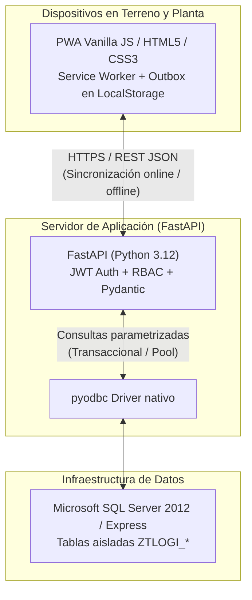

# Logística Forestal Pindó SA

Sistema integral para la coordinación, trazabilidad y control de fletes forestales desde el monte hasta la industria (aserradero / biomasa) y despachos comerciales a terceros.

Diseñado específicamente para operar en condiciones reales de terreno forestal en Misiones y Corrientes: alta resiliencia offline en zonas sin cobertura celular, interfaz visual industrial de alto contraste y compatibilidad directa con la infraestructura existente de base de datos corporativa.

---

## 🌲 Características Principales

- **Offline-First real para el monte:** La PWA (Progressive Web App) almacena catálogo, stock, tarifas y programas localmente en `localStorage`. Las acciones ejecutadas sin señal (relevamiento de pilas, inicio/fin de carga, novedades mecánicas, demoras) se encolan en un **outbox idempotente** y se sincronizan automáticamente con el servidor apenas se recupera la conectividad.
- **Trazabilidad Monte $\rightarrow$ Báscula:** Seguimiento en tiempo real de los camiones: *Disponible $\rightarrow$ En viaje a monte $\rightarrow$ En fila de espera $\rightarrow$ Cargando $\rightarrow$ En camino a planta $\rightarrow$ En báscula (bruto/tara/permanencia) $\rightarrow$ Retorno/Disponible*.
- **Control de Stock y Cosecha:** Descuento automático de pilas de madera (fino / grueso por especie y largo en pies) con validación estricta de stock disponible en origen y prioridad configurable (consumo propio de industria vs. venta a terceros).
- **Tarifario de Fletes y Liquidación:** Matriz de fletes por rodal de origen, destino (aserradero, biomasa, secadero, terceros), distancias (km asfalto + km tierra) y tipo de tracción del camión ($4\times2$ vs $6\times4$). Fórmulas de flete exactas: $\text{Flete} = \text{Tarifa} \times \text{Toneladas báscula}$.
- **Auditoría y Supervisión de Remitos:** Carga digital y física (foto + OCR asistido) de remitos con detección de discrepancias entre el volumen estimado en monte ($m^3$) y el peso neto registrado en báscula ($t$).
- **Gestión de Turnos y Descansos en Báscula:** Parametrización de franjas horarias operativas y pausas de atención para prever congestiones y demoras en puerta de fábrica.
- **UI/UX Industrial Pro Max:** Diseño optimizado para celulares táctiles (operación con guantes / sol directo en cabina), tablets y escritorios de supervisión; incluye modo Día y Noche (OLED Dark) persistente.

---

## 🏗️ Arquitectura y Decisiones Técnicas

El sistema está construido bajo principios de máxima autonomía, mínimo consumo de recursos y cero dependencias pesadas en el cliente:



1. **Backend:** [FastAPI](https://fastapi.tiangolo.com/) en Python 3.12 con tipado estricto, endpoints REST documentados automáticamente con Swagger/OpenAPI y autenticación JWT con control de roles (RBAC).
2. **Base de Datos:** Microsoft SQL Server 2012 / Azure SQL / SQL Express mediante `pyodbc`. Todas las entidades del módulo residen en tablas prefijadas `ZTLOGI_*` para no interferir con esquemas existentes de ERP/SAP.
3. **Frontend:** Vanilla JavaScript, HTML5 y CSS moderno nativo sin frameworks invasivos (sin Node/React/Vue). Carga instantánea, consumo ínfimo de memoria y compatibilidad total con navegadores de bajo costo en celulares Android de choferes y motosierristas.

---

## 👥 Matriz de Roles y Accesos

| Rol | Pantallas y Capacidades |
| :--- | :--- |
| **Transportista** | Selección de camión propio, visualización de programa asignado, reporte de disponibilidad para el día siguiente, registro de demoras / fallas mecánicas y visualización de fletes liquidados. |
| **Elaborador (Monte)** | Relevamiento de stock de pilas por especie/categoría/largo, visualización de la cola de camiones en espera, inicio y finalización de carga con detalle de trozas despachadas. |
| **Báscula** | Registro de ingresos con patente, pesaje bruto y tara, cálculo automático de peso neto y permanencia en planta, configuración de turnos y descansos. |
| **Supervisor** | Tablero integral de control, monitoreo de frentes de cosecha, cola en tiempo real, emisión diaria del programa de carga, pedidos de elaboración a contratistas y auditoría de remitos. |
| **Jefe de Logística** | ABM completo de rodales, destinos, contratistas y tarifario de fletes (valores por tonelada según tracción $4\times2$ / $6\times4$), importación masiva de tarifas vía CSV/Excel y análisis de fletes acumulados. |
| **Administrador** | Aprobación de altas de usuarios y camiones nuevos, asignación de roles, desbloqueo de cuentas y catálogos generales (especies de madera, destinos, contratistas). |

---

## 🚀 Puesta en Marcha Rápida

### 1. Requisitos Previos

- **Python:** 3.10 o superior (recomendado 3.12).
- **Controlador ODBC:** [Microsoft ODBC Driver 17 o 18 for SQL Server](https://learn.microsoft.com/sql/connect/odbc/download-odbc-driver-for-sql-server).
- **Motor SQL:** Microsoft SQL Server 2012+, SQL Server Express o Azure SQL Database.

### 2. Clonar el Repositorio

```bash
git clone https://github.com/Tincho-Salazar/LogisticaPindo.git
cd LogisticaPindo
```

### 3. Configurar el Entorno

Copia el archivo de variables de entorno de ejemplo:

```bash
cp backend/.env.example backend/.env
```

Edita `backend/.env` con la cadena de conexión correspondiente a tu servidor:

```ini
# Configuración de Red
HOST=0.0.0.0
PORT=8080

# Base de Datos SQL Server
SQL_SERVER=localhost\SQLEXPRESS
SQL_DATABASE=sapinfo
SQL_TRUSTED_CONNECTION=yes
# Si usas usuario de SQL en lugar de autenticación Windows:
# SQL_USER=sa
# SQL_PASSWORD=TuPasswordSeguro

# Seguridad
JWT_SECRET=tu-clave-secreta-super-aleatoria-de-produccion
MODO_PRUEBA=true
```

### 4. Instalar Dependencias

```bash
cd backend
python -m venv .venv

# En Windows:
.venv\Scripts\activate
# En Linux / macOS:
# source .venv/bin/activate

pip install -r requirements.txt
```

### 5. Inicializar la Base de Datos con Datos de Demostración

Para crear las 30 tablas `ZTLOGI_*` e insertar contratistas, camiones, rodales, tarifas y cuentas de prueba:

```bash
python scripts/reset_demo.py
```

### 6. Ejecutar la Aplicación

Desde la raíz del proyecto o desde la carpeta `backend`:

```bash
python run.py
```

El servidor detectará la IP de red local automáticamente e iniciará la aplicación en:
- **Local:** `http://localhost:8080`
- **Red LAN (celulares/tablets):** `http://[TU-IP-LOCAL]:8080`
- **Documentación Swagger de la API:** `http://localhost:8080/docs`

---

## 🔑 Credenciales de Demostración

Todas las cuentas demo utilizan la contraseña predeterminada: `Demo.2026`

| Rol | Usuario | Nombre / Asignación |
| :--- | :--- | :--- |
| **Supervisor** | `sup.ana` | Ana Benítez — Supervisora General |
| **Elaborador** | `elab.marcos` | Marcos Duarte — Serv. Forestales el Trébol |
| **Elaborador** | `elab.lucia` | Lucía Fernández — Forestal del Alto Paraná |
| **Transportista** | `transp.hector` | Héctor Gómez — Camión AF 412 KR ($4\times2$) |
| **Transportista** | `transp.raul` | Raúl Benítez — Camión AG 833 PT ($6\times4$) |
| **Báscula** | `bascula.rosa` | Rosa Martínez — Operadora Balanza Planta |
| **Jefe Logística** | `jefe.carlos` | Carlos Viana — Jefe de Logística y Abastecimiento |
| **Administrador** | `admin` | Administrador del Sistema |

---

## 🧪 Pruebas Automatizadas

El proyecto cuenta con un conjunto integral de pruebas unitarias, de integración y de interfaz de usuario de punta a punta:

```bash
# 1. Ejecutar pruebas unitarias de backend y reglas de negocio con pytest:
cd backend
pytest tests -v

# 2. Recorrido visual automatizado de roles con Playwright (Headless Chromium):
python tests/ui/ui_walk.py

# 3. Prueba de flujo operativo completo (Monte -> Báscula -> Outbox Offline):
python tests/ui/ui_flow.py
```

---

## 📁 Estructura del Proyecto

```text
LogisticaPindo/
├── run.py                 # Script de arranque en Python puro desde la raíz
├── README.md              # Documentación técnica general
├── .gitignore             # Filtro de archivos no versionables
├── docs/
│   ├── DECISIONES.md      # Registro formal de decisiones arquitectónicas
│   ├── ESTADO.md          # Bitácora de estado, hitos y pendientes
│   └── ESPECIFICACION_ORIGINAL.md # Especificación funcional histórica
└── backend/
    ├── run.py             # Script de arranque interno con autodetección de IP
    ├── schema.sql         # Definición DDL de las 30 tablas ZTLOGI_*
    ├── requirements.txt   # Dependencias de Python
    ├── Caddyfile          # Configuración de proxy inverso HTTPS
    ├── app/
    │   ├── main.py        # Punto de entrada FastAPI y middlewares
    │   ├── config.py      # Carga de variables de entorno
    │   ├── db.py          # Conexión pyodbc y helpers de consulta
    │   ├── auth.py        # JWT y encriptación de contraseñas bcrypt
    │   ├── reglas.py      # Lógica pura de cálculo (fórmulas, stock, fletes)
    │   ├── consultas.py   # Queries parametrizadas SQL Server
    │   ├── reportes.py    # Generación de reportes PDF (ReportLab)
    │   ├── ocr.py         # Asistente de lectura de remitos
    │   └── routers/       # Endpoints REST modulares por dominio
    ├── scripts/
    │   ├── reset_demo.py  # Reinicio y poblado de datos demo
    │   └── seed_demo.py   # Dataset de prueba con datos forestales
    ├── static/            # Frontend PWA (Vanilla JS / CSS3)
    │   ├── index.html     # SPA Shell
    │   ├── app.css        # Sistema de estilos industrial responsive (Light/Dark)
    │   ├── app.js         # Controlador principal y enrutador de vistas
    │   ├── views.js       # Componentes de UI y renderizado por rol
    │   ├── sheets.js      # Modales y formularios de acción
    │   ├── api.js         # Cliente HTTP con outbox offline en localStorage
    │   ├── util.js        # Formateadores, helpers y biblioteca de iconos SVG
    │   ├── sw.js          # Service Worker para caché offline
    │   └── manifest.json  # Manifiesto de instalación PWA
    └── tests/             # Batería de pruebas automatizadas
        ├── test_api.py    # Tests de integración de endpoints
        ├── test_reglas.py # Tests unitarios de fórmulas de negocio
        └── ui/            # Tests E2E de navegador con Playwright
```

---

## 📄 Licencia

Propiedad de **Pindó SA**. Todos los derechos reservados.

