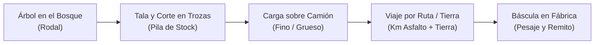
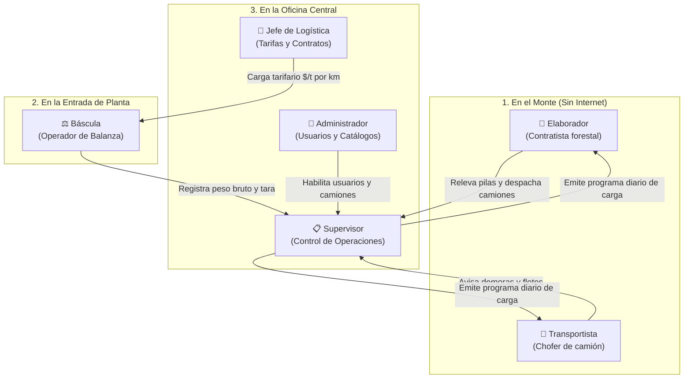
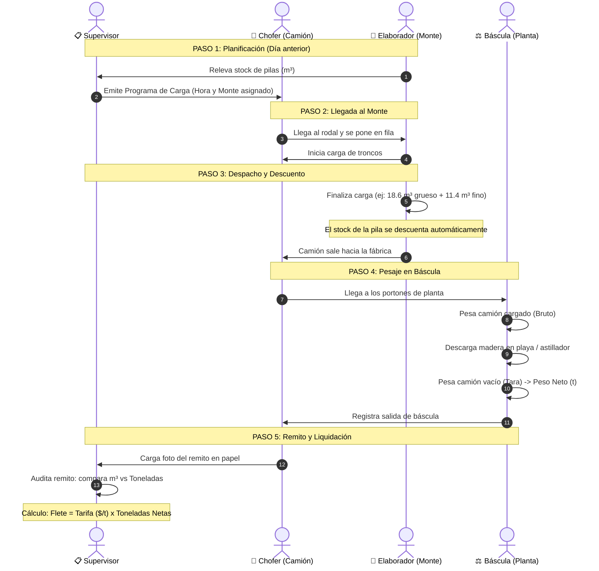
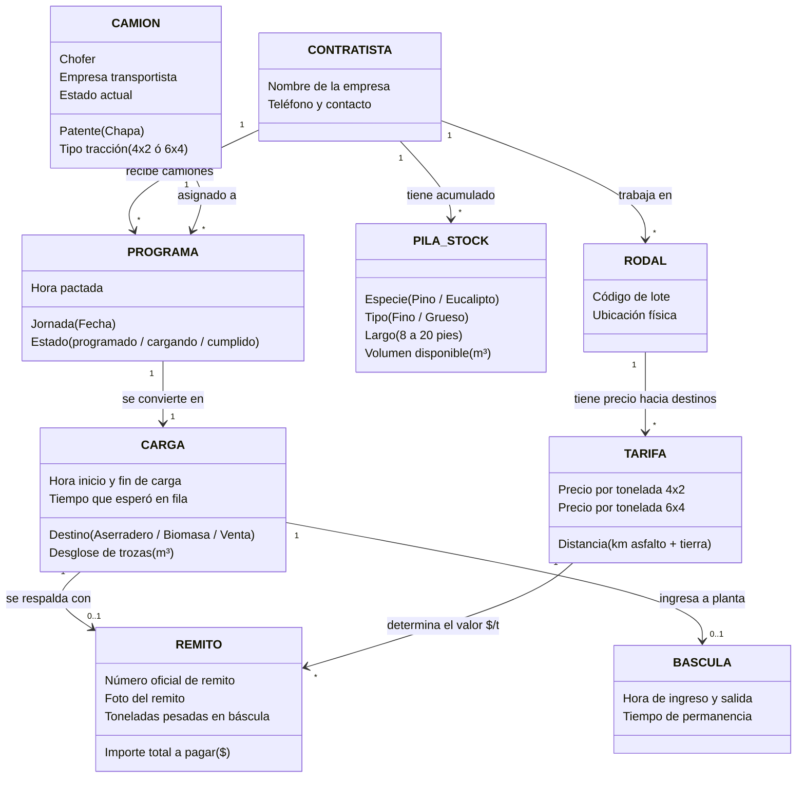

# Guía Integral: ¿De qué se trata el Sistema de Logística Forestal Pindó?

> Esta guía está pensada para entender el sistema **desde cero**, sin asumir ningún conocimiento previo de transporte de madera, logística ni informática avanzada.

---

## 1. El Problema del Mundo Real (La Historia Simple)

Imaginá este escenario:

1. **La Empresa (Pindó SA):** Tiene un aserradero moderno y una planta de generación de energía por biomasa en Puerto Esperanza (Misiones). Estas fábricas tragan cientos de toneladas de troncos de pino todos los días. Si se quedan sin madera, las máquinas se paran y la empresa pierde millones.
2. **El Bosque (El Monte):** Los árboles no están al lado de la fábrica. Están en campos forestales desparramados a 30, 60 o 120 km de distancia, en caminos de tierra roja, donde **casi no hay señal de celular**.
3. **Los Cosecheros (Elaboradores):** En el monte hay cuadrillas de contratistas con máquinas taladoras cortando pinos y apilando los troncos al borde del camino.
4. **Los Camiones (Transportistas):** Hay decenas de camioneros yendo y viniendo por caminos de tierra y rutas provinciales para buscar la madera y traerla a la fábrica.
5. **La Balanza (Báscula):** En la entrada de la fábrica hay una balanza gigante donde se sube el camión entero para pesarlo.

### ¿Qué pasaba antes de este sistema?
- Los camiones iban al monte sin saber si había madera lista para cargar.
- Llegaban 10 camiones al mismo tiempo al mismo monte y se armaba una fila de 4 horas parada, perdiendo tiempo y gasoil.
- En el monte no sabían qué madera cargarle a cada camión (si troncos finos para triturar o troncos gruesos para tablas de exportación).
- Como no hay señal de celular en el bosque, nadie en la oficina central sabía qué camión estaba cargando, qué camión venía en viaje o si alguno se había roto en la banquina.
- Al final de la quincena, pagar los fletes a los camioneros era una pesadilla de remitos de papel embarrados, tachados y números que no coincidían con la balanza.

### ¿Qué hace este software?
Es el **cerebro digital que coordina todo el circuito**: organiza qué camión va a qué monte, avisa cuánto tiempo falta, lleva la cuenta de los troncos cortados, calcula los tiempos de espera y liquida los fletes sin margen de error.

---

## 2. Diccionario Forestal en "Criollo"

Para entender las pantallas y la base de datos, sólo necesitás entender estos 8 términos:

| Término | ¿Qué significa en la vida real? | ¿Por qué le importa al sistema? |
| :--- | :--- | :--- |
| **Rodal** | Es un lote o parcela específica del campo (ej. `MMA07XC073`). Es el lugar físico exacto donde están los árboles. | Define de dónde sale la madera y qué distancia en km hay hasta la fábrica. |
| **Pila** | Es una montaña de troncos ya cortados y ordenados al costado del camino de tierra, esperando que los carguen. | Es el inventario o stock disponible. Si la pila tiene $100\text{ m}^3$, no podés mandar camiones a cargar $150\text{ m}^3$. |
| **Rollo Fino** | Troncos delgados (de 18 a 24 cm de diámetro). Suelen usarse para triturar (biomasa o pasta celulósica). | Tiene menor valor económico y se destina a usos específicos. |
| **Rollo Grueso** | Troncos anchos (más de 25 cm de diámetro). Son los más valiosos para cortar tablas y tirantes de madera. | La fábrica cuida este stock porque alimenta las líneas principales del aserradero. |
| **Largo en Pies** | La madera en la industria forestal argentina se corta en medidas estándar inglesas: 8, 10, 12, 14, 16, 18 y 20 pies. | Cada máquina del aserradero procesa largos específicos. |
| **$m^3$ vs. Toneladas** | En el monte no hay balanza, así que el contratista estima el volumen en **metros cúbicos ($m^3$)**. Al llegar a fábrica, la báscula lo pesa exacto en **toneladas ($t$)**. | El sistema ayuda a comparar si lo que dijeron que cargaron ($m^3$) tiene sentido con lo que pesó en báscula ($t$). |
| **Tracción $4\times2$ vs. $6\times4$** | $4\times2$: Camión con 1 eje tractor común (para ruta). $6\times4$: Camión con doble tracción trasera (para entrar profundo en caminos de barro). | La tracción define la tarifa: un $6\times4$ cobra una tarifa distinta por tonelada porque gasta más y llega más lejos. |
| **Industria vs. Ventas** | **Industria**: Madera propia para el aserradero de Pindó. **Ventas**: Madera que Pindó le vende a terceros (ej. papeleras, otros aserraderos). | El sistema descuenta primero el stock de donde corresponde para no mezclar la madera propia con la comercial. |

---

## 3. ¿Quién es Quién? (Los 6 Roles del Sistema)

Cada persona que usa la aplicación tiene un rol diferente y ve únicamente lo que necesita para su trabajo:

1. **El Transportista (Chofer):**
   - Abre la app en su teléfono celular.
   - Ve a qué monte tiene que ir hoy y a qué hora.
   - Cuando llega al monte y se pone detrás de otros camiones, aprieta **"Entrar en fila"**.
   - Si se le pincha una goma o se rompe en el camino, avisa desde la app (incluso si no tiene señal; se enviará solo cuando pase cerca de una antena).
   - Ve cuánto dinero va acumulando en fletes realizados.

2. **El Elaborador (Cosechero en el monte):**
   - Todas las tardes camina las pilas y anota en la app: *"Tengo 140 $m^3$ de pino grueso de 10 pies y 90 $m^3$ de fino de 8 pies"*.
   - Ve qué camiones están esperando en el camino.
   - Cuando el camión sube a la planchada, le da a **"Iniciar carga"**.
   - Cuando terminan de acomodar los troncos, le da a **"Finalizar carga"**, anotando qué cargó. El stock de la pila se descuenta automáticamente.

3. **El Operador de Báscula (En la entrada de la fábrica):**
   - Cuando el camión llega a los portones de la empresa, lo sube a la balanza y registra la entrada con la patente.
   - El sistema calcula cuánto tardó desde que salió del monte (si tardó 6 horas en un viaje de 1 hora, salta una alerta de demora en ruta).
   - Registra el peso bruto (camión + madera) y la tara (camión vacío cuando sale). La diferencia exacta es el **peso neto de madera**.
   - Si la balanza entra en horario de almuerzo o mantenimiento, activa el descanso para que los supervisores sepan por qué hay camiones esperando afuera.

4. **El Supervisor de Operaciones:**
   - Trabaja en la oficina mirando una pantalla grande.
   - Todos los días a las 18:00 hs arma el **Programa de Carga para mañana**: asigna a cada camión a qué contratista debe ir y a qué hora.
   - Monitorea el semáforo de frentes: si un contratista tiene poca madera, le manda menos camiones; si tiene mucha madera acumulada con riesgo de mancharse por el calor o la lluvia, le manda más camiones.
   - Audita los remitos cargados y revisa discrepancias.

5. **El Jefe de Logística y Abastecimiento:**
   - Define cuánto se paga el flete por tonelada según los kilómetros de tierra y de asfalto.
   - Importa planillas de Excel con las tarifas actualizadas.
   - Revisa reportes consolidados de toneladas transportadas e importes totales a liquidar a cada transportista.

6. **El Administrador:**
   - Aprueba los choferes y camiones nuevos que piden registrarse.
   - Bloquea accesos o resetea claves.

---

## 4. Diagrama de Flujo: El Ciclo de Vida de una Carga

Este es el recorrido completo de principio a fin de un camión con madera:

---

## 5. Cuadro Sinóptico: ¿Cómo se conectan los Datos?

El corazón del sistema en SQL Server son las tablas con prefijo `ZTLOGI_*`. Este cuadro muestra cómo se vinculan entre sí los conceptos:

---

## 6. La "Magia" Técnica Explicada en Palabras Fáciles

### ¿Cómo funciona la aplicación sin internet en medio del monte? (El Buzón de Cartas)
En los campos de Misiones muchas veces no hay 4G ni 3G. Si una aplicación común pierde la señal, muestra un cartel rojo de *"Error de conexión"* y se congela.

Este sistema implementa un **Buzón de Salida (Outbox)**:
1. Cuando el elaborador aprieta *"Finalizar Carga"* en el monte sin señal, la aplicación no intenta conectarse a internet.
2. Guarda los datos en la memoria interna segura del teléfono (`localStorage`).
3. La pantalla del elaborador se actualiza al instante como si estuviera conectado: la pila baja de volumen y el camión pasa al estado *"En viaje"*.
4. Cuando el chofer o el contratista viaja y su teléfono agarra aunque sea un punto débil de señal al borde de la ruta nacional 12, el sistema detecta la antena en segundo plano, abre el buzón y despacha todas las cargas pendientes al servidor central de una sola vez.

### ¿Por qué no usamos frameworks pesados como React o Angular?
Los choferes y cuadrillas usan teléfonos Android económicos (muchas veces con pantallas rayadas, memoria RAM limitada y procesadores lentos).
Una aplicación en React o Angular descarga megabytes de código JavaScript que hacen que el teléfono se caliente y tarde 10 segundos en abrir una pantalla.
Este sistema se programó en **Vanilla JS/HTML/CSS puro**:
- Pesa apenas unos pocos kilobytes.
- Abre de forma instantánea.
- No gasta el plan de datos móviles de los trabajadores.

### ¿Por qué Microsoft SQL Server 2012 y tablas ZTLOGI_*?
Pindó SA ya tiene su base de datos corporativa funcionando en un servidor central.
Para no arriesgar los datos contables ni romper el sistema de gestión existente:
- Todas las tablas de este nuevo módulo empiezan con `ZTLOGI_` (ej. `ZTLOGI_CARGAS`, `ZTLOGI_PILAS`, `ZTLOGI_REMITOS`).
- Viven en el mismo motor de datos, por lo que el área de sistemas de la empresa puede cruzar datos directamente con SAP/ERP sin necesidad de exportar e importar archivos a mano.

---

## 7. Resumen en Una Sola Frase

> **Este sistema es un semáforo inteligente y una calculadora automática que conecta el hacha en el monte con la balanza en la fábrica, asegurando que nunca falte madera en las máquinas, que ningún camión espere de más en la tierra colorada y que cada flete se pague con el peso exacto.**
